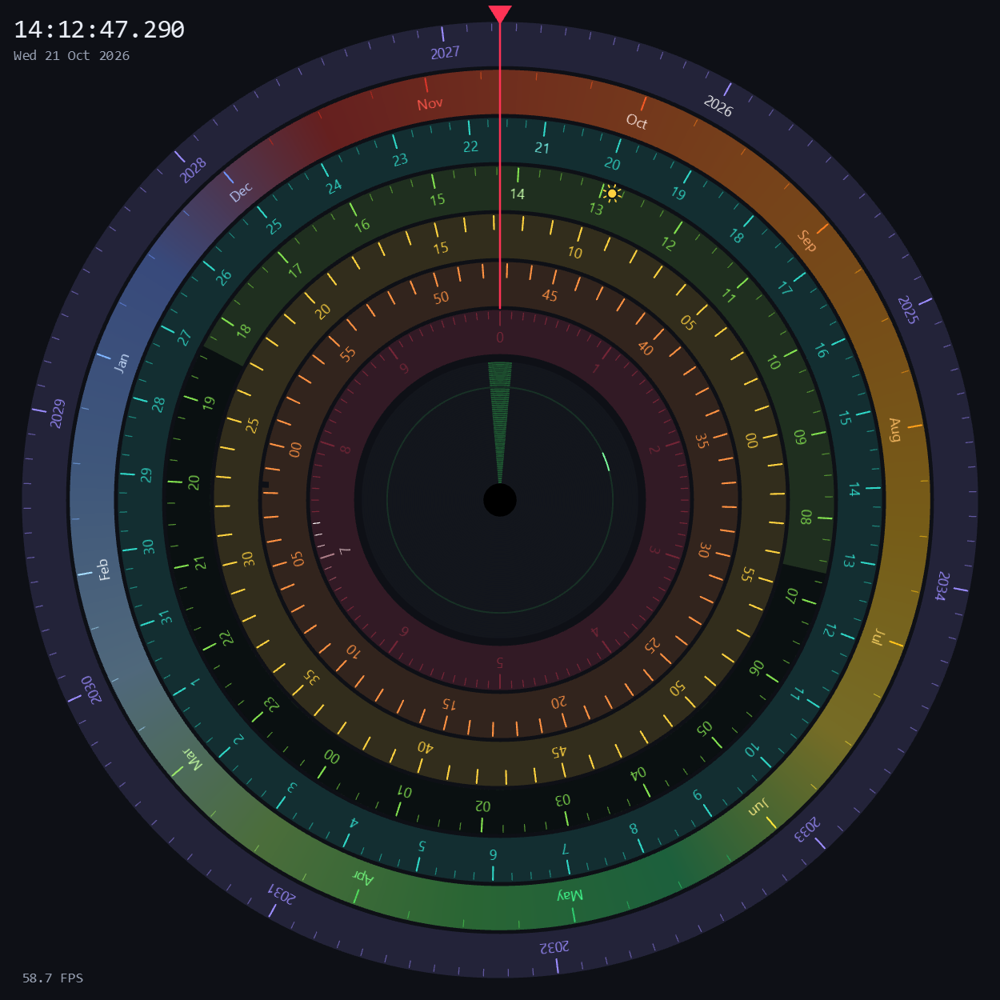
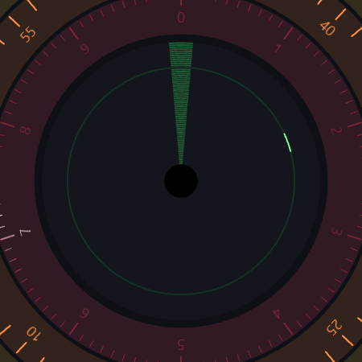

# Disc Clock

A fluid, 60 FPS clock made of concentric rotating rings — from years on the outside down to seconds in the center. Written in Python with PySide6 (Qt) and rendered through OpenGL with anti-aliasing and vsync.



## How to read it

Every ring turns clockwise so that the current value sits under the red indicator at 12 o'clock.

| Ring (outer → inner) | Shows | Details |
|---|---|---|
| Year | 10-year window starting at last year | Monthly sub-ticks |
| Month | Jan … Dec | Seasonal color gradient: icy winter, green spring, vivid summer, orange-to-red autumn |
| Day | 1 … days in the current month | 6-hour sub-ticks |
| Hour | 00 … 23 | Night is shaded from sunset to sunrise; a sun icon marks solar noon |
| Minute | 00 … 59 | |
| Second | 00 … 59 | |
| Ten seconds | 0 … 9 (fixed) | A light chases around once every 10 s; 100 ms ticks glow and fade |
| Center | 60 nested rings | One ring per second, starting from the innermost: its green segment accelerates and decelerates through a full turn, then hands over to the next ring |



The current time, date and frame rate are shown in the window corners.

## Requirements

- Python 3.10+
- [PySide6](https://pypi.org/project/PySide6/) (see [requirements.txt](requirements.txt))
- Internet access for sunrise/sunset data (optional — the clock works without it, just without night shading and the sun marker)

## Running

### Windows

```bat
start.bat
```

### Linux / Raspberry Pi

```sh
chmod +x start.sh
./start.sh
```

On first run the scripts create a `.venv` virtual environment and install the dependencies.

### Manually

```sh
python -m venv .venv
.venv/bin/pip install -r requirements.txt        # Windows: .venv\Scripts\pip ...
.venv/bin/python main.py --lat 37.3541 --lon -121.9552
```

## Location

Sunrise, sunset and solar noon are fetched from [sunrise-sunset.org](https://sunrise-sunset.org/api) once a day (retried every 10 minutes on failure), so a clock left running stays up to date.

- Set your location with `--lat` / `--lon`, or edit `LAT` / `LON` in `start.bat` / `start.sh` (both contain a list of example cities).
- If no location is given, it is estimated from your IP address via [ipapi.co](https://ipapi.co).
- Times are displayed in the computer's local time zone, so choose a location in that time zone.

## Controls

| Key | Action |
|---|---|
| `F11` | Toggle fullscreen |
| `Esc` | Quit |
| `Ctrl+C` (terminal) | Quit |

## Customizing

Most of the look is controlled by constants and values in [main.py](main.py):

- `HUB_FRACTION` — size of the central 60-ring area
- `SEASON_COLORS` — month gradient colors
- `RINGS` — ring order, colors, labels and sub-ticks
- `_draw_domino_rings` — segment width (`seg_deg`), greens (`idle` / `lit`), ring grey (`base`)

## Performance notes

- Rendering is synced to the display refresh rate; motion is time-based, so it stays correct at any frame rate.
- 4× MSAA is used. 8× roughly halves the frame rate on integrated GPUs.

## License

[MIT](LICENSE)
